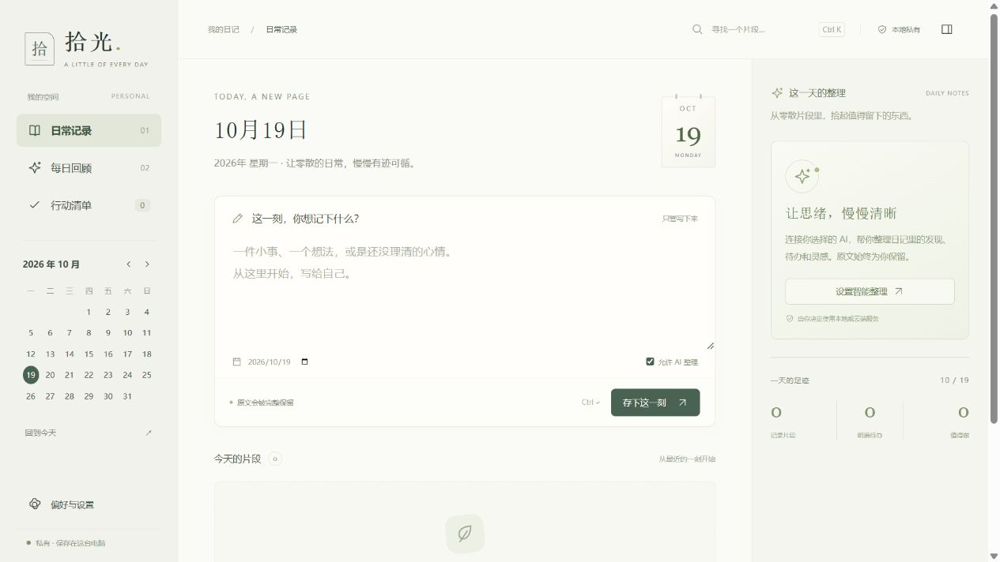
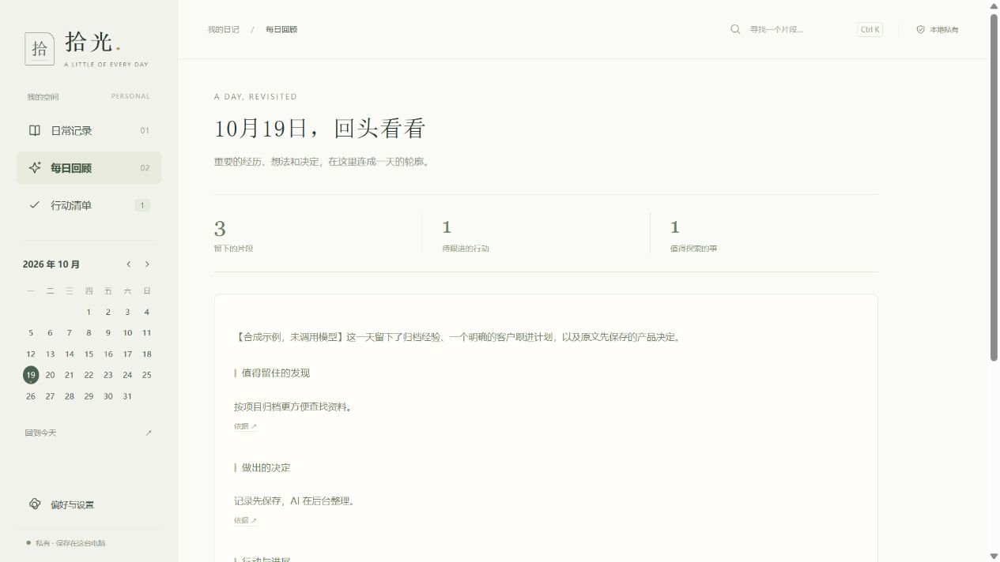
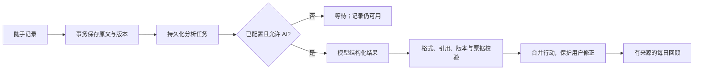

# 拾光 · Shiguang Diary

**把零散日记整理为可追溯的回顾与行动，同时保留原文和用户的最终决定。**

[](https://github.com/Ernest177/shiguang-diary/actions/workflows/ci.yml)

一个以本地数据为中心的个人智能日记应用。中文界面，面向电脑端；Python 标准库 + SQLite + 原生 JavaScript，无第三方运行依赖，无需前端构建。



**产品文档**：[设计思路](docs/case-study.md) · [架构与数据流](docs/architecture.md) · [迭代与评测](docs/iteration.md) · [版本记录](CHANGELOG.md) · [路线图](ROADMAP.md) · [验证依据](docs/verification.md)

## 为什么做这个项目

普通日记容易积累成难以回看的文本，任务工具又要求记录时先分类。直接交给模型整理会产生新问题：建议变成承诺、重复任务再次出现、慢请求覆盖新内容。

拾光保持「随手记录」的入口，把整理放在可靠保存之后，重点是**可信的数据流和用户控制权**。

| 痛点 | 设计回应 | 可检查的证据 |
| --- | --- | --- |
| 模型故障影响记录 | 原文先事务提交，分析进入持久化队列 | 未配置 AI 的降级测试 |
| 灵感误变成待办 | 区分待办、值得做和待澄清，保留引用 | 四类语义边界样例与校验 |
| 旧分析覆盖新编辑 | 记录版本 + 任务票据，写回前再次检查 | 在途修改竞态测试 |
| 重复整理覆盖用户决定 | 指纹、来源关系与修改保护 | 去重、取消与编辑保护测试 |
| 数据难以迁移恢复 | SQLite 一致性快照和事务导入 | 完整性、恢复与损坏数据拒绝测试 |

机制与样例检查不代表已经测得真实模型的语义准确率。

## 主要功能

- 每天多条记录：自动时间、补记日期、编辑历史、草稿恢复、Ctrl+Enter 保存。
- 单条分析与每日回顾：保留原文，结论可查看来源，失败有状态和重试入口。
- 行动管理：明确待办 / 值得做 / 待澄清，支持编辑、完成、取消、转换和撤销。
- 中文检索：日期浏览与关键词子串搜索。
- 数据掌控：自动快照、JSON 完整导入导出、Markdown 阅读导出。
- 自选 AI：本地或云端 Chat Completions 兼容接口，按记录选择是否参与分析。
- 关于我：一次开启自动积累，新日记复用整理请求，历史分片接续；成长足迹在本机检索，记忆和画像保留依据，随时可修正。
- 用量与费用：逐次记录输入、输出和总 Token，按用途查看重试与费用估算；支持月份筛选、单价快照和 CSV 导出。缺失用量明确标为未知。

「关于我」提供自动积累与原有手动方式。默认关闭自动积累；开启后，已有和以后的 AI 日记自动纳入，私密记录与主动排除的来源仍不参与。旧日记按每日额外请求上限分批整理，进度可见、随时暂停，参考预算达到后停止后续请求。原文保存在本机，云端模式仍会发送必要片段。每项理解均可修正或删除，机制与边界见[个人档案设计](docs/personal-archive.md)。

## 运行起来

需要 Python **3.10+**，无需安装第三方运行包。

```bash
git clone https://github.com/Ernest177/shiguang-diary.git
cd shiguang-diary
python app/server.py
```

打开 **http://127.0.0.1:8765**。Windows 可双击 `启动拾光.vbs`，后台启动服务后打开浏览器；设置页可退出服务。关闭网页不停止后台整理。

默认数据位于项目的 `data/`，独立于浏览器缓存，已排除 Git。移动或删除项目时要妥善保管其中的正式数据。

```bash
# 独立实例；替换为合适的数据目录
python app/server.py --port 8766 --data-dir /path/to/another-diary

# 不读取个人日记、不调用真实模型的检查
python -m unittest discover -s tests -v
```

Windows 双击入口经过实际检查，其他系统可用命令启动。

## 无密钥体验整理界面

默认关闭 AI，记录、检索和备份可直接使用。也可生成**明确标注的合成演示数据**，检查回顾、行动与来源交互：

```bash
python tools/create_demo.py
python app/server.py --port 8766 --data-dir .demo-data
```

访问 http://127.0.0.1:8766。演示不调用模型，与正式 `data/` 分开；生成器拒绝覆盖已有数据库。示例不是实际推理评测。

<details>
<summary>查看每日回顾的合成演示截图</summary>



</details>

## 核心逻辑



核心约束：**模型输出是派生数据，原文和用户决定拥有独立生命周期。** [查看竞态与状态设计复盘](docs/case-study.md)。

## AI 接入与隐私

设置页选择服务模式，填写模型、基础地址与密钥，测试后保存。

- 本地示例地址：`http://127.0.0.1:11434/v1`，需要自行运行模型服务。
- 云端填提供方的 HTTPS 兼容地址并确认发送范围，程序追加 `/chat/completions`。
- 密钥绑定当前地址，更换地址不会自动把旧密钥交给新提供方。
- 本地失败不会自动回退到云端，按记录排除分析的内容不会进入新的分析上下文。

当前适配器尚未配置厂商专用的思考开关与 `response_format`，结构化结果依靠提示词和应用校验。模型默认思考可能影响耗时与花费，真实服务需单独验证。模板见 [app/prompts.py](app/prompts.py)，校验见 [app/ai.py](app/ai.py)。

## 持续迭代与评测

当前版本 **1.4.1** 延续 20 条单条分析 + 4 组每日回顾的公开合成样例与 11 个个人档案的离线合约样例，增加增量缓存、暂停接续、来源撤回、预算限制、请求合并与输入精简的回归。分别检查数据流程与模型原始输出，保留不同验证层的边界。

```bash
# 默认离线，不联网、不读取个人日记，不需要密钥
python -m evals.run --baseline evals/baselines/contract-v1.json
python -m evals.about_contract
python tools/check_request_costs.py
```

报告生成到 `.eval-results/`，包括误提 / 漏提 / 误关闭、日期与已有行动关联、引用与来源覆盖。应用、提示词、数据集、评分器和门禁分别记录版本；可拒绝不可比的实验，并逐例检查退步。GitHub Actions 自动执行离线回归。

**离线合约响应是手写替身，得分不是模型准确率。** 真实模型评测需要显式运行，只发送同一组合成文本，记录耗时和提供方用量；当前尚未运行真实质量基线。具体命令、计费边界、人工复核和发布流程见[迭代说明](docs/iteration.md)。

## 技术结构

```text
app/server.py       本机接口、访问检查与生命周期
app/store.py        数据模型、事务、版本与备份恢复
app/ai.py           模型适配、校验与后台队列
app/prompts.py      有版本与哈希登记的提示词
app/about.py        经历、授权、记忆与失效生命周期
app/about_ai.py     个人档案模型协议、来源校验与整理任务
app/growth.py       增量提取、本地缓存、历史分片与成长足迹
app/request_context.py 输入精简、短编号映射与本地结果回执
web/                本地 HTML / CSS / JavaScript
tests/              存储、竞态、恢复与 HTTP 场景
evals/              合成标注、合约基线、真实评测与比较器
tools/              合成演示数据与仓库内容检查
docs/               复盘、架构、取舍与验证依据
```

## 验证与边界

本地基线：**86 项 Python 自动检查、个人档案 / 行动 / 用量页面的渲染逻辑检查，以及 24 + 11 个离线合约样例通过**；v1.0 还实际检查了 Windows 启动与原有浏览器流程。v1.2 之后的浏览器自动化工具不可用，未完成新的浏览器视觉与交互验收。真实服务的个别合成案例与连接检查不代表全面模型质量评测。GitHub Actions 在 Windows / Ubuntu 与 Python 3.10 / 3.12 组合下复现检查，结果以顶部链接为准。

模型替身验证协议、引用和流程，不证明真实推理质量。本项目尚未发布真实模型准确率、生产规模或性能收益。[验证说明](docs/verification.md)

- 个人单机应用，只监听 `127.0.0.1`，不应直接作为公网服务部署。
- 日记数据库未额外加密；Windows 用 DPAPI 保护密钥，其他系统使用权限受限文件。
- 指纹解决相同标题的去重，语义合并仍依赖模型；引用存在不等于结论正确。
- 基础搜索最多展示最近 500 个跨日匹配；逐日读取当日全部记录。
- 单条上限 60,000 字符，每日分析输入超过 120,000 字符会明确提示。
- 时区支持上海、新加坡、东京与 UTC；手机、同步、附件、周报，以及覆盖全部日记的月报仍属于后续范围。当前个人月度回顾只使用单独授权的资料。
- v2 数据库首次升级前生成快照，支持恢复 v1 / v2 备份；不提供自动降级。保留 `data/upgrade-backups/`，回退前需先导出新增内容。

本项目在 AI 辅助下实现与迭代，文档区分可复现机制、人工检查和待评估能力。

## 下一阶段

先用当前 Aliyun 配置建立真实质量、耗时和用量基线，验证记忆、画像与月度变化的语义质量，再据此调整参数与提示词。随后完善使用反馈和升级恢复体验。每阶段的痛点、完成依据与实现状态见[产品路线图](ROADMAP.md)。

贡献方式见 [CONTRIBUTING.md](CONTRIBUTING.md)，数据与凭证边界见 [SECURITY.md](SECURITY.md)。
