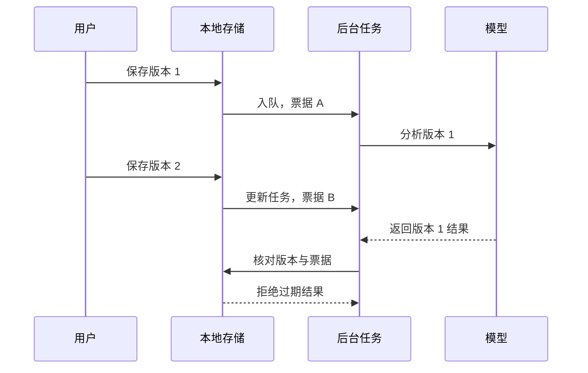

# 从「记下来」到「值得回看」：拾光项目复盘

## 先明确要解决什么

用户每天记录一到多次，内容混合经历、情绪、任务和灵感。记录时强制分类增加负担；只做每日摘要，又容易丢掉行动、依据和变化。

产品闭环定义为：**低负担记录 → 可靠保存 → 有依据的整理 → 人可修正的行动 → 每日回顾**。

第一版选择电脑单机、本地存储、自选 AI。手机、同步、附件和复杂知识库没有进入第一版。先验证记录与整理闭环，同步涉及的身份验证、冲突与远端生命周期留待后续。

## 把痛点转为可以验收的规则

| 表达 | 应有处理 | 避免的错误 |
| --- | --- | --- |
| 明天联系客户 | 明确待办，保留时间原话 | 行动埋进摘要 |
| 也许值得联系客户 | 值得做，供用户选择 | 建议变成承诺 |
| 今天已联系客户 | 不新建同样的未完成待办 | 完成事项又被要求做一次 |
| 不准备联系客户 | 不生成该待办 | 忽略否定词 |
| 昨天见了朋友 | 所属日与实际创建时间分别保存 | 事件时间伪造创建时间 |

规则进入提示词，也进入应用校验与测试。保守词句检查是补充防线，不是完整的自然语言理解算法。

## 难点一：慢请求不能覆盖新内容

典型竞态：版本 1 保存后开始请求模型；用户改成版本 2；版本 1 的结果后返回。直接按记录 ID 写回，会展示旧内容的整理。

设计同时校验**记录版本**与**任务票据**：前者表示原文是否变化，后者表示同一版本是否已重新安排更新的分析。

实现位置：[`Store.save_entry`](../app/store.py)、[`Worker.analyze_entry`](../app/ai.py)。`test_stale_ai_result_is_not_applied` 在请求期间修改原文，断言旧结果没有落库，行动也未被误创建。

「请求成功」与「结果仍可使用」是不同条件，单机应用同样需要处理。

## 难点二：整理不能夺走用户的决定权

行动不是每次分析后整体覆盖的临时列表。用户会改标题、完成任务、取消计划、拒绝建议。

- 行动状态独立于分析结果，拥有 ID、状态和修改标记。
- 优先使用已有行动 ID，再用规范化标题指纹合并确定性重复。
- 用户修改后设置保护标记，重跑不能抹掉标题和状态。
- 拒绝建议保留状态，避免物理删除后下次又被创建。
- 来源修改或删除后，手动处理过的行动保留，并标记来源失效。

代价是状态与来源更复杂；标题指纹也覆盖不了所有同义改写，语义去重仍依赖模型。

证据：`test_user_cancellation_and_edit_survive_reanalysis`、`test_user_deleted_rejection_does_not_reappear_after_edit`、`test_undo_action`。

## 难点三：可追溯，并承认模型会出错

原文、分析、行动和每日回顾分别存储。每项提取保存来源记录、版本和连续原文引用。输出经过格式、枚举、关联与引用检查，编造的引用被拒绝。

每日回顾使用当日允许分析的记录与行动上下文，返回后再次核对上下文签名，变化则拒绝写入。

引用存在能证明「依据确实存在」，不能证明「推理正确」。复杂否定可能被逐字引用却依然被误解，因此界面保留人工修改入口，真实语义质量需要单独评测。

证据：`test_invented_evidence_is_rejected`、`test_disabled_ai_content_is_not_sent_to_day_context`。目前没有声称真实模型提取准确率。

## 难点四：可恢复，而不只是能导出

使用 SQLite 一致性备份，在临时文件完成完整性检查后原子替换。恢复前创建快照；导入先在临时数据库验证结构与关联，再以事务写入正式数据库。

「合并」保留本机记录与用户选择；「完整恢复」替换日记数据。合并还需映射同一行动指纹的不同 ID，否则来源关系可能触发外键错误。

证据：备份恢复、导入去重、损坏关联拒绝、损坏分析拒绝与行动指纹映射测试。

## 为什么没有堆更多技术

第一版是低并发个人应用。SQLite、短事务与单工作线程使数据生命周期容易验证；远程数据库、消息系统与向量检索会增加运维和同步问题，未必改善最先要解决的体验。

代价明确：内置 HTTP 服务仅用于回环地址，长内容和多设备仍有边界。升级条件写在[关键决策](decisions.md)。

## 下一步怎样评价效果

| 维度 | 本版证据 | 计划的评价方式 |
| --- | --- | --- |
| 持久化与任务一致性 | 25 项检查的相关场景 | 增加服务重启与并发窗口检查 |
| 行动识别 | 合成规则样例与校验 | 标注明确承诺、模糊建议、否定与他人计划，分别统计漏提与误提 |
| 完成状态识别 | 保守引用与语句检查 | 单独统计误关闭率 |
| 回顾可信度 | 来源与引用存在性校验 | 人工评价事实支持、覆盖与矛盾保留 |
| 花费与延迟 | 尚未发布真实统计 | 按相同样本比较 Token、重试次数与端到端耗时 |

本项目使用 AI 辅助开发，可讨论需求拆解、状态设计、验证与取舍；不据此推断未经测量的生产规模或收益。
